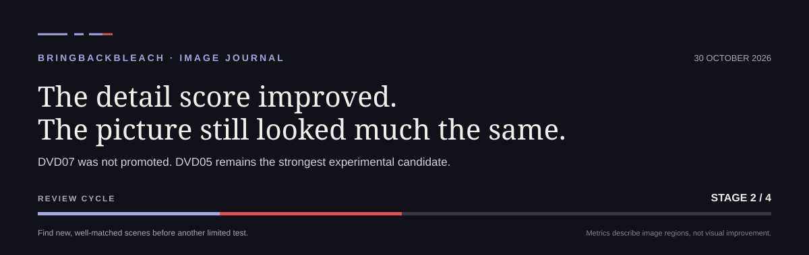

# Estado do projeto — 30 de outubro de 2026

## Em que ponto estamos?

O candidato experimental DVD05 conserva mais sinal fino e intermédio nas regiões analisadas. Nas oito regiões de validação já consultadas, o erro médio nessas bandas baixou **47,21%** e **42,40%**, respetivamente, face à base usada na comparação. A estrutura de baixa frequência ficou praticamente igual (**−0,33%**).

Isto é um resultado de medição, não significa que a imagem pareça 47% melhor. Nas prévias revistas, a diferença visual continua subtil. O candidato ainda não está aprovado para episódios completos.

## Problemas e resposta atual

| Problema | O que estamos a fazer |
| --- | --- |
| A textura fina e intermédia continua pouco visível. | Medir cada escala separadamente e investigar uma correção limitada, sem aumentar o efeito global nem afirmar que todo o sinal é grão verdadeiro. |
| Os exemplos de ação e efeitos são poucos. | Rever novas regiões narrativas dos DVDs já disponíveis. O conjunto de treino atual tem apenas uma região desse tipo; as regiões de validação atuais não incluem ação. |
| Alguns candidatos melhoram a imagem estática, mas pioram a consistência entre frames. | Manter a comparação temporal como critério obrigatório. Os candidatos que regrediram ficam experimentais e não substituem a referência atual. |
| A conversão para vídeo comprimido também altera detalhes. | Os controlos mostraram que a conversão de cor pode contribuir para a perda. Não vamos fazer mais testes de encoder sem uma pergunta concreta. |

## Barra das etapas

**1 de 4 etapas concluída; a segunda está em curso.** A barra mostra apenas as etapas deste ciclo de investigação, não uma percentagem do projeto inteiro.

1. Diagnosticar onde se perde detalhe — concluído.
2. Rever mais exemplos de textura, ação e efeitos — em curso.
3. Fazer uma experiência limitada, se os dados revistos forem suficientes — por fazer.
4. Rever a imagem e a consistência entre frames antes de decidir — por fazer.

## Próximo passo

Selecionar e rever algumas regiões adicionais de ação, efeitos e textura intermédia nos DVDs dos episódios já disponíveis. Depois decidir se a cobertura é suficiente para uma única experiência delimitada. Não está previsto prolongar automaticamente o treino atual.

## O que este resultado não demonstra

- Não prova que todo o detalhe fino seja grão original ou que possa ser recuperado com certeza.
- Não é uma avaliação cega: as regiões de validação já foram consultadas durante o desenvolvimento.
- Não certifica a ausência de cintilação nem aprova o processamento integral de episódios.

Os gráficos deste diário são desenhados a partir de medidas agregadas. O site inclui só três fotogramas de exemplo, emparelhados com as respetivas saídas; não contém episódios completos, dados de treino nem pesos do modelo.

## Comparações visuais

O [site do projeto](https://skolastico.github.io/BringBackBleach/) inclui três exemplos antes/depois de um teste anterior do EP008 com o modelo v7 a 2×. A cortina interativa permite comparar a fonte 576p com a saída ampliada. Estes exemplos já tinham sido vistos durante o desenvolvimento: ajudam a perceber o aspeto, mas não são uma avaliação cega nem uma aprovação do candidato DVD05 atual. Não publicamos episódios completos, conjuntos de treino ou pesos.

